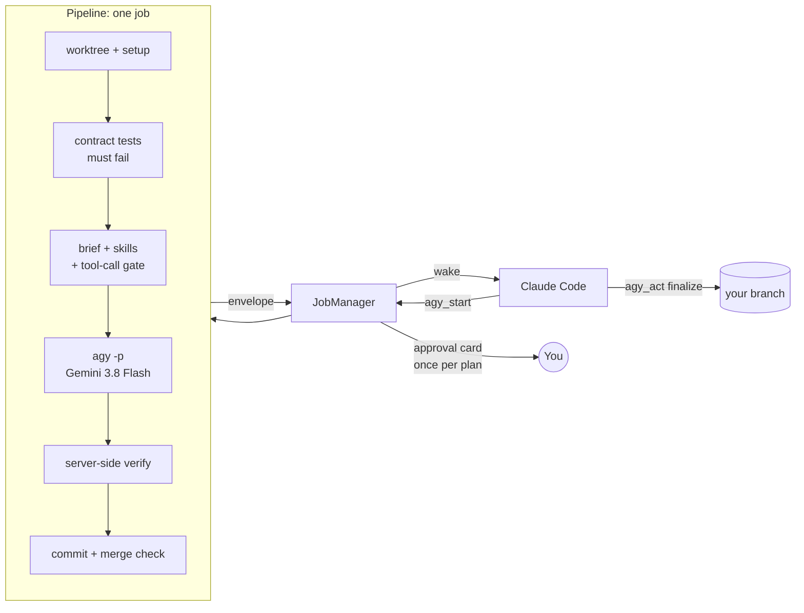

# agy-foreman

Hand plan tasks from Claude Code to Gemini 3.8 Flash as headless, CI-style runs of the Antigravity CLI, and merge only what passes your tests.

[](https://github.com/mountaser/agy-foreman/actions/workflows/ci.yml)
[](LICENSE)


```
agy 🟢🟢🟢🟢🟢🟢🔵 6/7 tasks · #7 You shall not pass · › running · 42 tool calls · plan 41m07s
```

_The Claude Code status line while Gemini works on the last task of a plan. Each task gets a marker: done, running, failed or not started._

agy-foreman lets Claude Code hand tasks from a plan to Gemini 3.8 Flash through Google's `agy` CLI. Each task runs in agy's headless mode, which Google's docs describe for scripting and CI, and is treated like a CI job: one non-interactive `agy -p` run with a fixed brief, in its own git worktree. The server then runs your tests on the result, and only branches that pass get merged.

It works with plans written by [Superpowers](https://github.com/obra/superpowers) and changes written with [OpenSpec](https://github.com/Fission-AI/OpenSpec), as well as one-off tasks.

> **Status:** v0.1, pre-release. It runs end to end on Windows, Linux and macOS.

## Works with your plans

agy-foreman reads the plan file you already have and runs one task per job:

| Plan source                                                        | File                               | A task is                                      |
| ------------------------------------------------------------------ | ---------------------------------- | ---------------------------------------------- |
| [Superpowers](https://github.com/obra/superpowers) `writing-plans` | any `.md` plan                     | a `### Task 3: …` section                      |
| [OpenSpec](https://github.com/Fission-AI/OpenSpec) change          | `openspec/changes/<name>/tasks.md` | a `## 3. …` section with its `- [ ] 3.1` items |
| none                                                               | none                               | a task description passed to `agy_start`       |

For Superpowers plans, test code blocks in a task become the contract tests, and the `Create:` / `Modify:` file lists become Gemini's checklist. For OpenSpec changes, the open `- [ ]` items do that job, and the change's `proposal.md`, `design.md` and `specs/` are added to Gemini's brief, so it gets the context even when the change folder isn't committed yet.

## Quick start

You need Node 20 or newer, git 2.38 or newer, Claude Code, and the [Antigravity CLI](https://antigravity.google/docs/cli) (`agy`) logged in to your Google account.

```bash
npm install -g agy-foreman
```

Set up a repository you want to use it in:

```bash
cd your-repo
agy-foreman init           # config + status line
agy-foreman doctor         # checks node, git, agy login
agy-foreman install-skill  # teaches Claude to delegate
claude mcp add agy-foreman -- agy-foreman serve
```

On Windows, register it as `claude mcp add agy-foreman -- cmd /c agy-foreman serve`.

Restart Claude Code and ask it to run a plan, for example: _"Run task 3 of docs/plans/auth.md with Gemini."_ You get one approval card for the plan. Later tasks run without asking until the plan file changes.

## How it works



1. Start: Claude calls `agy_start` with a task and a token estimate; jobs that are cheaper to do directly are refused.
2. Approve: one card per plan, valid for 24 hours or until the plan file changes.
3. Isolate: a git worktree, your setup command, and contract tests whose own cases must fail before Gemini starts.
4. Gate: a hook decides every tool call; your global agy settings can't widen it. Its policy lives outside the worktree, commands must be plain (no redirection, `$( )` or background `&`), and the run stops if the hook's files change.
5. Run: Gemini runs headless; if the quota runs out, you choose retry, continue without Gemini, or wait.
6. Verify: protected files (tests, test-runner config, `package.json`) are restored, then the tests run. Every contract case must be in the JUnit report and pass, and the counts and git state are checked for tampering.
7. Merge: Claude reviews the result and squashes the branch.

When a job fails, the failure is recorded as an incident and Claude writes a one-line lesson. Lessons that match a new task are added to its brief. A lesson that shows up three times is offered to you as a permanent rule for the skill.

## Reference

### MCP tools

| Tool         | Purpose                                      |
| ------------ | -------------------------------------------- |
| `agy_status` | Running jobs, cooldown, top lessons          |
| `agy_start`  | Start an `implement` or `explore` job        |
| `agy_get`    | Progress or the final result                 |
| `agy_act`    | Finalize, follow up, cancel, record a lesson |

### CLI

| Command                           | Purpose                           |
| --------------------------------- | --------------------------------- |
| `serve`                           | The MCP server (default)          |
| `wait <job>`                      | Block until a job ends            |
| `watch [job]`                     | Live progress in a terminal       |
| `statusline`                      | Install or remove the status line |
| `init`, `doctor`, `install-skill` | Setup                             |

### Configuration

`init` creates `.agy-foreman.json` in the repo root. For a vitest project, with one allowed command added by hand:

```json
{
  "test_command": [
    "npm",
    "test",
    "--",
    "--reporter=default",
    "--reporter=junit",
    "--outputFile.junit=reports/junit.xml"
  ],
  "setup_command": ["npm", "ci"],
  "test_report": "reports/junit.xml",
  "allowed_commands": ["npm run typecheck"]
}
```

| Key                  | Default       | Meaning                                                                 |
| -------------------- | ------------- | ----------------------------------------------------------------------- |
| `test_command`       | none          | Command the server runs to verify                                       |
| `test_report`        | none          | JUnit report: test counts, and required to check contract tests         |
| `setup_command`      | none          | Runs in each new worktree                                               |
| `allowed_commands`   | `[]`          | Extra commands Gemini may run, as whole words (`npx tsc` ≠ `npx tsc-x`) |
| `unknown_commands`   | `deny`        | `deny`, `allow` or `ask_user`                                           |
| `protected_paths`    | see below     | Files Gemini may not change                                             |
| `approval`           | `per_plan`    | `per_plan` or `per_task`                                                |
| `effort`             | `high`        | `low`, `medium` or `high`                                               |
| `max_concurrent`     | `2`           | Jobs at once                                                            |
| `max_runs_per_hour`  | `10`          | Hourly cap                                                              |
| `refuse_ratio`       | `1.5`         | When delegating costs more than doing it                                |
| `allowed_mcp`, `web` | `[]`, `false` | MCP tools and web access for Gemini                                     |
| `gate`               | `elicitation` | `client` if your client has no approval cards                           |

`protected_paths` defaults to the tests (`test/**`, `tests/**`, `*.test.*`, `*.spec.*`, `test_*.py`, `*_test.*`, `conftest.py`), the files that decide how they run (`package.json`, vitest, vite, jest, playwright, karma and mocha config, `tsconfig*.json`, `pyproject.toml`, `pytest.ini`, `setup.cfg`, `tox.ini`, `Makefile`), and `.agy-foreman.json`. Setting it replaces the whole list.

## Limitations

- **Gemini 3.8 Flash only**, with effort `low`, `medium` or `high`. Other models in agy need plans that this project doesn't target.
- **Implement jobs need a test command.** Without a machine check there is nothing to verify, so the skill tells Claude not to delegate.
- **Contract tests need a JUnit report that names each test's file.** vitest and pytest do (`init` sets both up); jest needs jest-junit with `addFileAttribute`, and Go a converter such as gotestsum. Without `test_report`, jobs with contract tests are refused.
- **Tasks that need a new dependency or a config change** can't be done by Gemini, since `package.json` and the runner config are protected. Make that change yourself first.
- **agy starts your global agy MCP servers on every run.** The gate denies Gemini access to them, but they still start up. agy has no per-run switch to turn this off.

## Terms of service

agy-foreman is not affiliated with Google.

It uses agy the way Google describes [headless mode](https://antigravity.google/docs/faq): for scripting and CI. Every task is one non-interactive run with a fixed brief in a throwaway git worktree, and the result is checked by your test suite, like a CI job. It never touches your login and never switches accounts.

Google's FAQ also says wrapping agy in third-party agents isn't supported on consumer plans. If you want to be fully covered, use it with a Gemini Enterprise account.

agy-foreman is provided as is under the MIT license. You're responsible for how you use it with your Google account.

## Development

```
src/
├── agy/        run(request) → Outcome: spawns agy -p, parses stream-json, detects quota, kills the process tree
├── pipeline/   runJob(spec) → Envelope: worktree, contract tests, gate and hook, guard, verify, report
├── jobs/       JobManager: approval, token gate, queue, quota card, progress, ledger, lessons
├── server.ts   the four MCP tools
├── cli.ts      serve, wait, watch, statusline, init, doctor, install-skill
└── statusline.ts
skills/gemini-delegation/   the skill (SKILL.md and 7 references)
```

```bash
npm ci
npm test            # unit and integration tests with the fake agy; CI runs them on Windows, Linux and macOS
npm run test:ci     # typecheck, formatting check, then the tests (what agy-foreman runs to verify its own jobs)
npm run test:live   # one small real agy call (uses a little quota)
```

## Contributing

Bug reports and pull requests are welcome. For bigger changes, please open an issue first so we can talk it through.

Before you send a PR, run `npm run test:ci` (typecheck, formatting and tests), and add a test if you're fixing a bug.

## Credits

- [agy-bridge](https://github.com/sshahzaiib/agy-bridge) by Shahzaib (MIT): agy-foreman started as a fork of it.
- [claude-agy-mcp](https://github.com/PyModel/claude-agy-mcp) by elkaix (MIT): the stream-json parser and the fake `agy` used in the tests are adapted from it.

The license notices for both are in [NOTICE](NOTICE).

## License

[MIT](LICENSE) © 2026 Mountaser Halak
